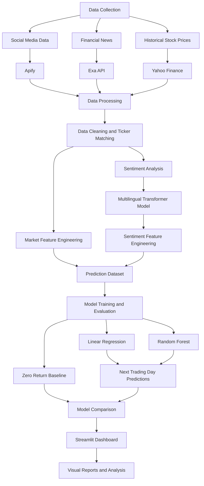

# Project Architecture
## Hang Seng Social Sentiment & Price Prediction Agent

## Architecture Explanation

### 1. Data Collection
- Apify collects social media discussions.
- Exa collects financial news.
- Yahoo Finance provides historical OHLCV market data.

### 2. Data Processing
- Cleans collected records.
- Identifies stock ticker mentions.
- Combines news, social and market datasets.

### 3. Sentiment Analysis
- Uses a multilingual Transformer model.
- Classifies financial text into sentiment categories.
- Calculates sentiment scores and confidence.

### 4. Feature Engineering
- Calculates historical returns.
- Generates moving averages and volatility features.
- Creates lagged sentiment features.

### 5. Model Training
- Trains Linear Regression and Random Forest models.
- Compares predictions with a zero-return baseline.
- Evaluates MAE, RMSE and directional accuracy.

### 6. Dashboard
- Displays market information.
- Shows sentiment analysis.
- Presents experimental stock predictions.
- Displays model evaluation results.
